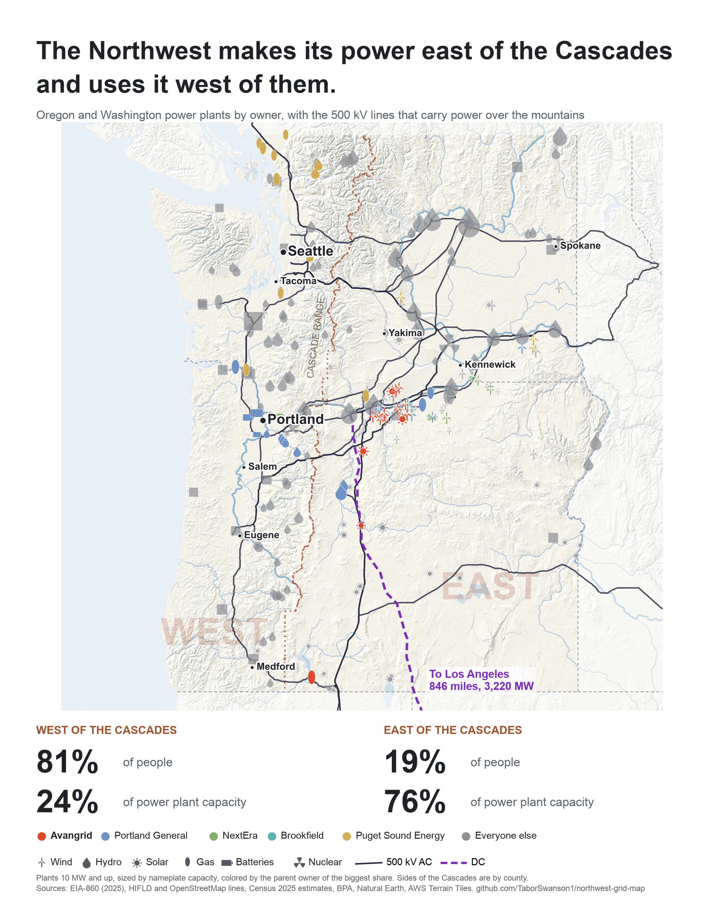

# Northwest Grid Map

Work in progress. A map of where Oregon and Washington make their power, where they use it, and the lines that connect the two.

**Finding so far:** 76% of the two states' power plant capacity is east of the Cascades, and 81% of people live west of them.



## How to run it

```bash
python3 -m venv .venv && .venv/bin/pip install -r requirements.txt
cd src
../.venv/bin/python fetch.py     # downloads raw data into data/raw
../.venv/bin/python plants.py    # data/clean/plants.csv, plant_owners.csv
../.venv/bin/python lines.py     # data/clean/lines.geojson, substations.geojson
../.venv/bin/python build_web.py # docs/data, the layers the web map loads
../.venv/bin/python poster.py    # charts/poster.png
```

## Sources

| What | Source |
|---|---|
| Power plants, owners | EIA-860, 2025 |
| Transmission lines | HIFLD, archived copy (US government data, last checked 2014 to 2018) |
| Newer lines, substations, cross-check | OpenStreetMap contributors, ODbL |
| Population | Census Bureau county estimates, 2025 |
| State and county boundaries | Census Bureau cartographic boundary files, 2024 |
| Parent companies | One source per row in `data/reference/parents.csv` |

Daily notes are in `log.md`.
